<p align="center">
  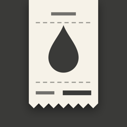
</p>

<h1 align="center">WageDrip · 窝囊费</h1>

<p align="center">A salary ticker that shows the money you have earned so far today, this month and this year, on a receipt that never stops printing.</p>

<p align="center">
  
  
  
  
  
  
  
  <br>
  
  
  
  
  
  <a href="https://github.com/AndyUneducated/WageDrip/releases"></a>
</p>

<p align="center">
  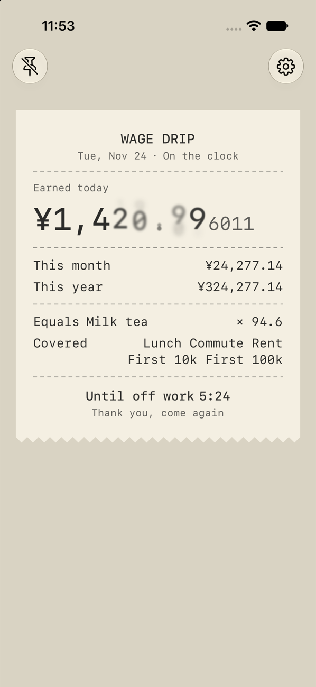
  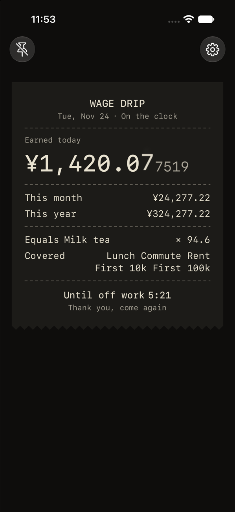
  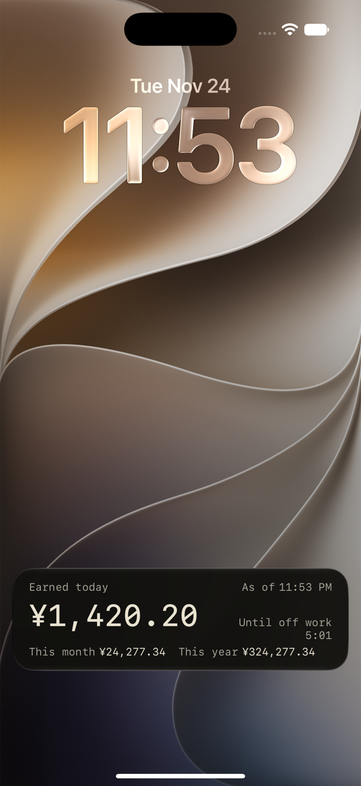
  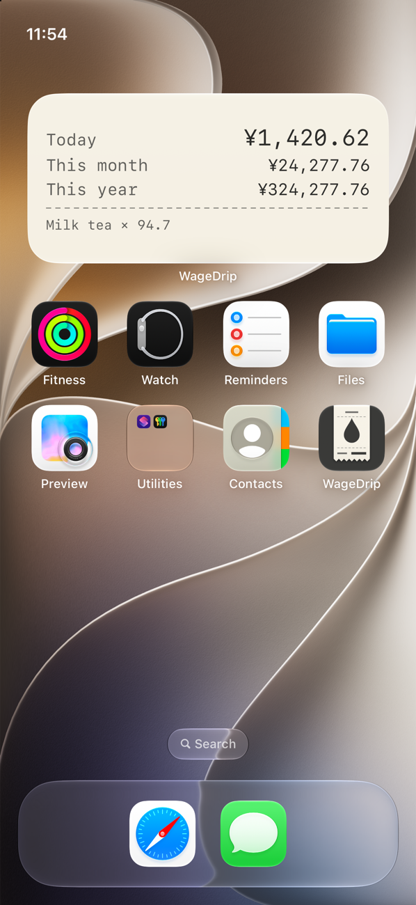
</p>

> The Chinese name 窝囊费 is slang for "the pittance you put up with". The app is self-deprecating on purpose.

## Contents

- [What it does](#what-it-does)
- [Using the app](#using-the-app)
- [How the numbers are calculated](#how-the-numbers-are-calculated)
- [Architecture](#architecture)
- [How each surface stays up to date](#how-each-surface-stays-up-to-date)
- [Build and run](#build-and-run)
- [Project layout](#project-layout)
- [Known limits](#known-limits)
- [Data sources](#data-sources)

## What it does

| Area | Details |
|---|---|
| Pay input | Annual (base, bonus and stock each switchable), monthly, or hourly |
| Periods | Today, this month, this year. Show any combination |
| Work schedule | Fixed hours, or flexible hours with adjustable weighting |
| Calendars | China public holidays with make-up workdays, US federal holidays, manual per-day overrides |
| Money | Pre-tax or after a deduction rate you set; display in another currency at a daily or manual rate |
| Extras | Equivalents ("equals 94.7 milk teas"), milestones ("lunch is covered") with optional notifications |
| Surfaces | App, Home Screen and Lock Screen widgets, Live Activity and Dynamic Island, Mac menu bar, Apple Watch app |
| Privacy | No account, no backend. Everything stays on the device |

## Using the app

### First launch

Three steps, then the receipt starts printing:

1. **Region.** China or United States. Sets the default holiday calendar, currency and reference prices.
2. **Pay.** Pick annual, monthly or hourly and enter the amount.
3. **Hours.** When work starts and ends. Lunch counts as paid time.

### The receipt

| Part | Meaning |
|---|---|
| Header | Date and current status: before work, on the clock, flex hours, off the clock, day off |
| Headline amount | The highest-priority period you selected. Rolls like a meter while you are being paid |
| Other periods | The remaining selected periods, to two decimals |
| Equals | The headline amount expressed as a number of an everyday item |
| Covered | Milestones already reached in their period |
| Until off work | Countdown to the end of work. Fixed hours only |

Toolbar buttons:

- **Pin** (top left, iPhone and iPad): start or end the Live Activity by hand.
- **Gear** (top right): settings.

### Settings

| Section | What you can change |
|---|---|
| Pay | Pay type and amounts, pay currency |
| Deductions | Show amounts after deductions; rate from 0% to 60%; four rough presets (China tier 1: 22%, China other: 18%, US tier 1: 32%, US other: 25%) |
| Hours | Start and end time; flexible hours and the working-hours share |
| Calendar | Region, holiday calendar, optional start date, days marked as work or rest |
| Display | Which periods to show; decimal places from 0 to 8 (default 6) |
| Currency | Display currency; daily automatic rate or a manual rate |
| Equivalents and milestones | Edit items and prices, choose which equivalent shows, toggle milestone alerts |
| Live Activity | Show automatically at work |

### Widgets

| Widget | Where | Shows |
|---|---|---|
| Small | Home Screen, Mac desktop | One period of your choice |
| Medium | Home Screen, Mac desktop | All selected periods and the equivalent |
| Rectangular | Lock Screen | One period of your choice |
| Inline | Lock Screen, above the clock | One period of your choice |
| Circular | Lock Screen | One period, abbreviated (742, 1.2k, 14k) |

- Add them the usual way: touch and hold the Home Screen or Lock Screen, then add a widget and search for WageDrip.
- To change a widget's period, touch and hold it and choose Edit Widget. Two small widgets side by side can show "Today" and "This month".
- Widgets advance every minute during paid hours.

### Live Activity and Dynamic Island

- The current amount is the largest element. "As of" shows when it was last refreshed; the countdown ticks every second.
- With **Show automatically at work** on, it appears by itself at your start time on workdays (with one alert sound) and settles when work ends.
- The Dynamic Island shows a drop icon and today's amount.

### Apple Watch

<p>
  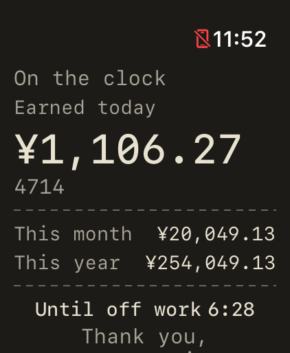
  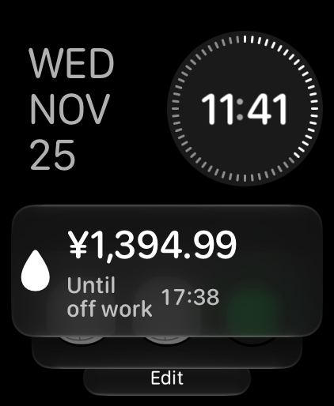
</p>

- The watch app is one small receipt: today's amount ticking, the other periods, and the countdown.
- It has no settings of its own. Change anything on the iPhone and the watch follows within a few seconds; it needs the iPhone app to have been opened once.
- The iPhone's Live Activity shows in the watch's Smart Stack, with the app icon at the top of the watch face. Tapping it opens the watch app.

### Mac menu bar

- The menu bar title is today's amount, ticking every second.
- Click it for a mini receipt, with buttons to open the main window or quit.

### Milestone alerts

- Turn on **Milestone alerts** under Settings › Milestones and allow notifications.
- Each milestone has a name, an amount and a period (day, month or year).
- Alerts fire at the moment your earnings cross the amount.

## How the numbers are calculated

### Is today a workday?

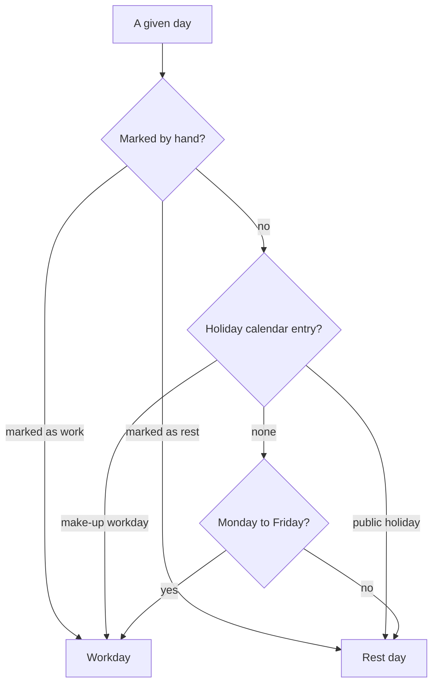

### Day wage

| Pay type | Monthly pay M | Day wage D |
|---|---|---|
| Annual | (base + enabled bonus + enabled stock) ÷ 12 | M ÷ workdays in that month |
| Monthly | as entered | M ÷ workdays in that month |
| Hourly | not used | hourly rate × scheduled hours per day |

- Spreading monthly pay over the month's **actual** workdays means the running total lands exactly on M at month end. Holidays and weekends earn nothing.
- Example: February 2027 in China has 15 workdays after Spring Festival and one make-up Sunday. Monthly pay of ¥30,000 gives a day wage of exactly ¥2,000.

### Within the day

The share of the day's wage earned by a given time:

| Time of day | Fixed hours | Flexible hours (default weight 80%) |
|---|---|---|
| Before work starts | 0% | 0% |
| Start to end of work | rises evenly from 0% to 100% | rises evenly from 0% to 80% |
| End of work to midnight | stays at 100% | rises evenly from 80% to 100% |

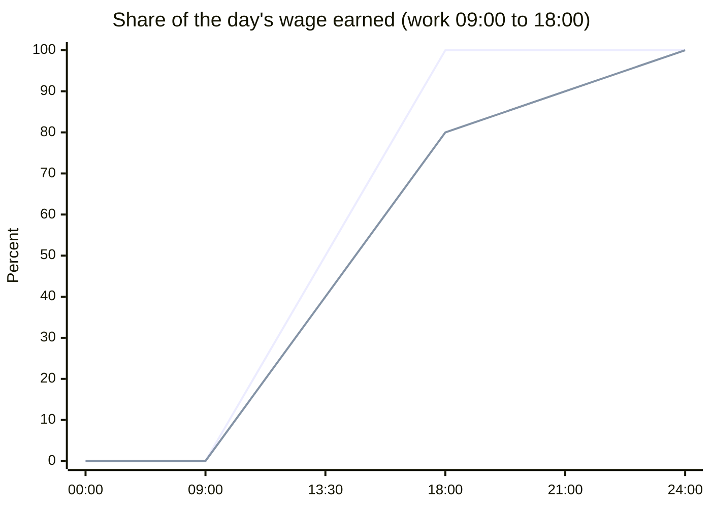

The upper line is fixed hours; the lower line is flexible hours.

### Totals and display

- **Today** = D × share earned so far.
- **This month** = wages of completed workdays this month + today.
- **This year** = pay of completed months + this month. Days before an optional start date earn nothing.
- **Shown amount** = gross × (1 − deduction rate, if after-tax display is on) × exchange rate.
- All money is `Decimal`. Amounts are truncated, never rounded up, so the app never shows money you have not earned yet.

## Architecture

All calculation lives in a pure Swift package. The app and the widget extension only present and schedule, and share one JSON settings blob through an App Group.

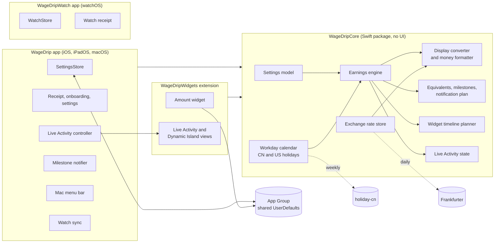

| Layer | Responsibility | Tested by |
|---|---|---|
| `WageDripCore` | Every rule and number: calendars, wage, curves, totals, conversion, schedules | 90 unit tests (Swift Testing) |
| `Shared` | App Group access, receipt theme, localized names, diagnostics log | Used by both targets |
| `WageDrip` | Screens, settings store, Live Activity control, notifications, data refresh | Simulator and device checks |
| `WageDripWidgets` | Widget and Live Activity views, widget configuration intent | Simulator and device checks |

## How each surface stays up to date

| Surface | Mechanism | Freshness |
|---|---|---|
| App receipt | Redrawn every frame from the engine | Continuous |
| Mac menu bar | Redrawn every second | 1 second |
| Apple Watch app | Computed on the watch from settings the iPhone sent; redrawn five times a second | Continuous |
| Widgets | A timeline of pre-computed entries, one per minute during paid hours | About 1 minute |
| Live Activity amount | Updated only when the app gets to run | About 7 to 9 minutes in the background |
| Live Activity countdown | Driven by the system clock | 1 second |

The Live Activity cannot compute anything between updates and there is no push server, so its amount is refreshed opportunistically:

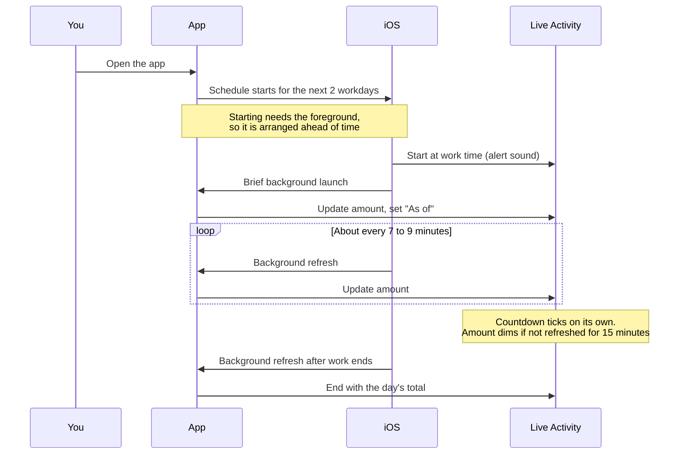

## Build and run

### Requirements

| Tool | Version | Note |
|---|---|---|
| Xcode | 27 or later | iOS, iPadOS, macOS and watchOS 27 SDKs |
| XcodeGen | 2.48 or later | `brew install xcodegen` |
| Apple account | Any | A free Personal Team works |

### Steps

1. Generate the Xcode project. It is not checked in; `project.yml` is the source of truth. Find your team ID under Xcode › Settings › Accounts.

```bash
DEVELOPMENT_TEAM=YOUR_TEAM_ID xcodegen generate
```

2. Open the project.

```bash
open WageDrip.xcodeproj
```

3. The first time you build with a team, register the App Group once: for both the `WageDrip` and `WageDripWidgets` targets, open Signing & Capabilities and tick `group.com.andyuneducated.wagedrip` under App Groups. This step cannot be done from the command line.
4. Choose a simulator or device and run.

### Tests

```bash
swift test --package-path Packages/WageDripCore
```

### Diagnostics

Tap the Version row in Settings five times to reveal a Diagnostics page. It logs every widget reload and every Live Activity start, update and end, with median intervals.

## Project layout

| Path | Contents |
|---|---|
| `Packages/WageDripCore` | Calculation core and data model, with unit tests |
| `WageDrip` | App: receipt, onboarding, settings, Live Activity control, notifications |
| `WageDripWidgets` | Widgets and Live Activity views |
| `WageDripWatch` | Apple Watch app, embedded in the iPhone app |
| `Shared` | Code compiled into both the app and the extension |
| `project.yml` | XcodeGen project definition |
| `docs/specs` | Design spec, including on-device measurements |
| `docs/plans` | Implementation plan |
| `tools/make-icon.swift` | Script that draws the app icon |

## Known limits

- **The Live Activity amount is not live.** It refreshes when the app gets to run. Use a widget for a figure accurate to the minute.
- **Automatic appearance needs an occasional launch.** Each time you open the app it schedules the next 2 workdays. Go more than 2 workdays without opening it and the Live Activity stops appearing until you do.
- **Flexible hours and the 8-hour cap.** iOS ends a Live Activity after 8 hours, which is shorter than a start-to-midnight day.
- **Apple Watch.** The watch app has no complications or Smart Stack widget yet, cannot change settings, and never goes to the network: it uses the exchange rate and holiday data the iPhone last sent. The Live Activity always mirrors to a paired watch; to hide it, turn WageDrip off under Settings › Smart Stack › Live Activities on the watch. The watch app has been tested in the simulator only.
- **Free Apple accounts.** Apps expire after 7 days and a device holds at most 3 such apps. No iCloud, so settings do not sync between devices. No push.
- **One pay rate per year.** "This year" is projected back from your current pay; mid-year raises are not tracked.
- **No overnight shifts.** Work must start and end on the same day.
- **Third currencies.** An equivalent or milestone priced in a currency that is neither your pay currency nor your display currency is taken at face value.

## Data sources

| Data | Source | Refresh |
|---|---|---|
| China public holidays and make-up workdays | [NateScarlet/holiday-cn](https://github.com/NateScarlet/holiday-cn), scraped from State Council notices. 2026 and 2027 are bundled | Weekly check |
| US federal holidays | Computed by rule, including observed-day shifts | None needed |
| Exchange rates | [Frankfurter](https://frankfurter.dev), European Central Bank reference rates | At most once a day |
